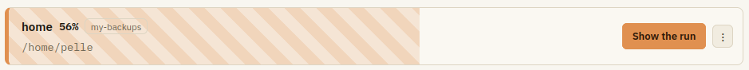
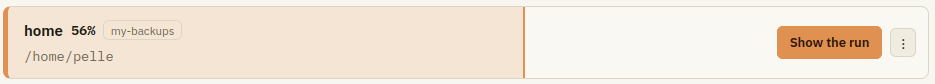
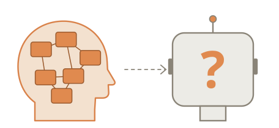
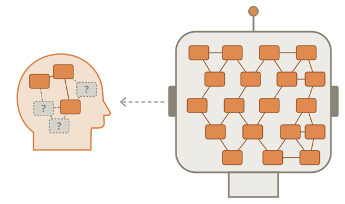
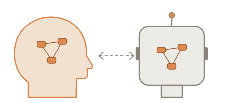
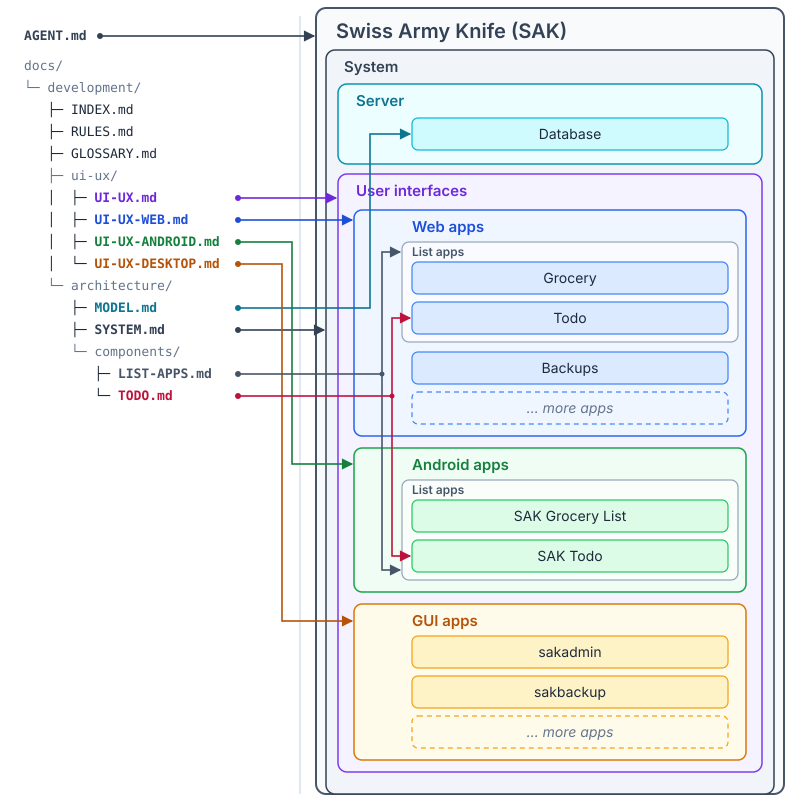

Like everyone and their dog, I cannot resist the urge to say one or two words about AI usage in my private projects (at least I am not starting a podcast about it). As laid out in my [initial plan]() for this project, the size and tech stacks touched in the planned solution (Android apps, Rust-based native apps) are partly way out of my comfort zone, so my plan is to also use this project to figure out an AI development process for this undertaking.

# Discovery

Probably the easiest (and sometimes the most fun) phase is the AI-assisted discovery. Especially for the UI part, the capabilities of current models allow me to skip the abstract design phase in tools like Figma or Sketch and directly try out concepts and feature ideas with a native look & feel across all platforms.

For someone like me who last built a native GUI application in Delphi, this allows me to quickly iterate on ideas and come up with templates and design patterns.

For example, I can create three different variants of the backup progress indicator using native components and a mocked backend, to get a feel for how each one looks and behaves.

**backup progress bar iterations**




It's important not to get lost in this process. It's perfectly fine to flesh out the design details of my application, but in my experience, trying to evaluate overarching user flows this way leads straight into circular-prompting hell.

For those, I turned back to classic conceptual flow diagrams using [LikeC4](https://likec4.dev/), which lets me spot flows and dead ends in how users move through my application.

**screen flow example for sakadmin**


# Context

After the discovery phase, I usually have a pretty good model in my head of how a certain feature should look and behave. The big question now is how to convert this model into a context an AI can read to help me with the actual implementation.



I have looked at several solutions that were derived from Karpathy's [LLM Wiki](https://gist.github.com/karpathy/442a6bf555914893e9891c11519de94f) idea, for example [Google's OKF](https://cloud.google.com/blog/products/data-analytics/how-the-open-knowledge-format-can-improve-data-sharing) and especially the way [chatto](https://chatto.run) is developed, as described in this [blog post](https://www.hmans.dev/blog/chatto-is-robots).

Especially the [Architecture Decision Record](https://github.com/chattocorp/chatto/blob/main/.agents/skills/adr/SKILL.md) and [Feature Decision Record](https://github.com/chattocorp/chatto/blob/main/.agents/skills/fdr/SKILL.md) skills with their accompanying review skills led to very concise documentation of every technical and feature decision.

The issue, though, was that while each record on its own was concise, together they piled up quickly, and after a few iterations the AI had more context of how the system should look and behave than I did. The amount of generated documentation needed constant reduction to keep it at a level I could digest while still grasping the whole system (keep in mind this is a side project, not my full-time job). Looking into what the AI wrote into those documents, much of it was assumptions the AI made or derived from the current state, which were not always wrong, but sometimes were. A more rigorous review process of the ADRs and FDRs would likely have reduced those issues, but I did not want to become a full-time PO for my own side project.




## Taming the context

Still, this is a small side project, and not a distributed system with hundreds of developers, so I need a way to preserve context in a form I can understand without having to read the equivalent of the Lord of the Rings trilogy in ADRs and FDRs. At the same time, it has to be enough for the AI to assist me during development. To solve this, I moved the **R** in AD**R** and FD**R** from the end of the word to the front, to create **R**ules on how the system should work.

The idea is that a rule is a very condensed version of an [A|F]DR, with just enough context for human and AI: no deep context, no history, no alternatives that have been looked at, just a specification of how a certain aspect of the whole system is supposed to work now.

For example, the ~98-line ADR that described how error messages are presented on the API becomes rule `API-1`:

> `API-1` **One form for every error.** Errors answer `{"errors": [{"code": "...", "message": "..."}]}`, for each
problem its code, the same in every language, and one readable sentence in the language of `Accept-Language`.

How rules are built is described at length in [RULES.md](https://github.com/pellepelster/swiss-army-knife/blob/main/docs/development/RULES.md), but the first five rules are the most important:

```markdown
# Rules

- `RULE-1` **A rule is a decision with an id.** A rule is one decision on how SAK is built or how it behaves, which
  the code, the tests and the documents follow until the rule changes. Text that only explains or describes is no
  rule. A rule is written once; other text refers to it by its id.
- `RULE-2` **The title is the rule in short.** The title says the decision in two to eight words, e.g. **Soft delete
  only.**, not only its subject, e.g. not **Deletes.**
- `RULE-3` **An id is a name for good.** The prefix of an id is the name of its chapter or of its component, in
  capitals and not shortened; one subject has one prefix in all documents. A new rule gets the next number of its
  prefix. An id never changes and is never used again, also when its rule is deleted. A rule that moves to another
  document gets a new id there, and every reference to it changes in the same commit.
- `RULE-4` **Plain words in the present tense.** A rule is written in ASD-STE100 Simplified Technical English, with
  the words of the glossary. It says what is true, in the present tense and the active voice, e.g. "The backend keeps
  …", not "The backend should keep …". "Never" says what is forbidden. A rule does not use "should"; an example in a
  rule comes with "e.g.".
- `RULE-5` **One decision for each rule.** A rule says one decision, and why when the reason is not clear.
```

These rules greatly help to boil down the essence of each decision. [RULES.md](https://github.com/pellepelster/swiss-army-knife/blob/main/docs/development/RULES.md) lives inside the [docs/](https://github.com/pellepelster/swiss-army-knife/blob/main/docs/) folder, which is referenced from the root [AGENT.md](https://github.com/pellepelster/swiss-army-knife/blob/main/AGENT.md). That file also holds another instruction that is vital to keep the AI in check:

> - Never add, change, move or delete content of `docs/development/` and of this file on your own, also when a change, a review or a fix makes it necessary or incorrect; the reviews in docs/development/reviews/ are the exception. Show the user the exact new text (and the old text of changed content), wait for the explicit agreement, write exactly the agreed text. An agreement is for one change; an instruction to move or to shorten text is not an agreement to its new text. When code and a rule do not agree, stop and ask.

In my experience, the rules together with the need for explicit consent from the developer help to form a dense and concise context for developers and AI that is suitable for smaller projects with a limited scope.




# Implementation

Now that the description of the system is persisted in the form of rules, the next step is the implementation. Before any code gets written, the AI has to find the rules that apply to the part of the system it touches, without reading all of them. Here I make use of the fact that the rules reference a hierarchy of components that make up the whole system, very much like the root AGENT.md can be refined by more detailed AGENT.md files for individual components.



The Todo app is a good example of the rule hierarchy: [UI-UX.md](https://github.com/pellepelster/swiss-army-knife/blob/main/docs/development/ui-ux/UI-UX.md) defines global UI/UX rules common to all user interfaces, which are then detailed in [UI-UX-WEB.md](https://github.com/pellepelster/swiss-army-knife/blob/main/docs/development/ui-ux/UI-UX-WEB.md) for web-based apps.
The same is true for the behaviour of the app itself: [LIST-APPS.md](https://github.com/pellepelster/swiss-army-knife/blob/main/docs/development/architecture/components/LIST-APPS.md) defines how list-based apps behave in general, with the details for the Todo app in [TODO.md](https://github.com/pellepelster/swiss-army-knife/blob/main/docs/development/architecture/components/TODO.md).


As usual, the root [AGENT.md](https://github.com/pellepelster/swiss-army-knife/blob/main/AGENT.md) serves as an entry point for all agents, detailing what to find where, together with some prime directives that describe universal rules that are true for the whole system. Notably, the one that had the biggest effect here (again borrowed from chatto) was:

> - Write all new or changed documentation in ASD-STE100 Simplified Technical English, with the vocabulary of
[`docs/development/GLOSSARY.md`](https://github.com/pellepelster/swiss-army-knife/blob/main/docs/development/GLOSSARY.md).

which led to more concise and easier-to-read docs, and the shared [GLOSSARY.md](https://github.com/pellepelster/swiss-army-knife/blob/main/docs/development/GLOSSARY.md) led to consistent wording across all apps and docs.


The actual code writing (or generation) exposes the same issues I had with the content of `docs/development/`: I want assistance from AI, but I still want to be in control and be able to understand how the system is built on the lowest level. For my workflow, I decided against automatic PR creation and instead restricted the AI to making all changes on `main`:

> * All changes happen on main, except when directed otherwise

This allows me to directly see the changes in the code, and enter a local code → review → validate cycle, which benefits greatly from having both a human and an AI in the review part. While the AI is much more thorough when it comes to finding weird or hard-to-find edge cases, I often observed architectural and coding style issues while looking at the proposed implementations. Those largely (but not entirely) went away with more detailed and thus way longer rules, but then again, this moved my focus too much into managing specs, and for this project I wanted to stay close to the code.

The issues ranged from simple smells (like implementing e-mail address validation four times) to classes accumulating way too many responsibilities, to weird attempts at breaking dependency cycles using `Class.forName(<clazz>)` patterns. The code still worked and would likely have stayed maintainable for quite some time. Whether it is (or was) good is at least open for debate and also walks the fine line of taste, which I don't want to follow up on here because it would be beyond the scope of this post.

# Feedback

Now, with perfectly implemented features, I needed what many AI-assisted projects lack: users. As the "IT guy" in my family, I was in the lucky position of being able to force my grocery app on my poor wife and children, scaling the user base from 1 to 5 in only 10 minutes :-), closing the development cycle with the most important thing for every project: user feedback.

In summary, after a few months of usage and roughly 70 releases during that time, I can say that AI in combination with a human (me) can catch a lot of issues that would definitely have slipped through the cracks before. But real-life usage still surfaced many issues that even a detailed review by two or three frontier models did not anticipate, even for a simple grocery app. Although most of them were minor, they included issues like content not being scrollable, data loss on device rotation and broken layouts caused by different screen sizes. That last one was especially interesting: the AI had claimed it verified the layouts with screenshots on every common device type.

My conclusion until today is, that the setups works well as a single developer and together with AI I was able to produce software with a higher (estimated) standard and fewer bugs than, before because it helped me to fill in the boring parts that I would previously have skipped due to time constraints (especially test coverage).  